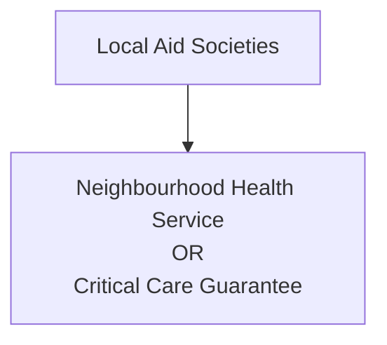
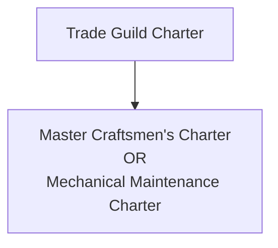
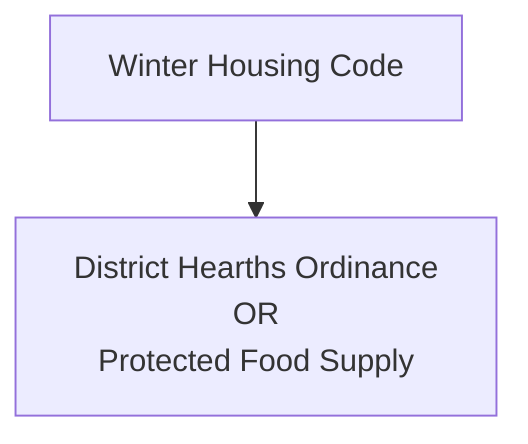
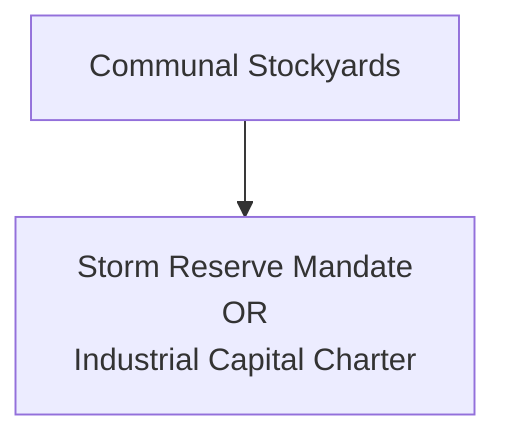

# Civic laws

Version 3.30.1 includes 12 research-free laws arranged in four choice trees, alongside the four existing researched charters. Open Adaptation in the Book of Laws, or Administration in The Last Autumn. Pan or zoom outward to see the new trees around the native branches. No new book replaces a native category.

The first law in each new tree is available as soon as the scenario allows law signing, without research or any previous law. It has a 12-hour cooldown. Then choose ONE of its two follow-ups, each with a 24-hour cooldown and no research requirement. Signing one permanently excludes its sibling using the native law exclusion-group system. These choices are independent of Order/Faith and the existing charters. Morale changes happen once when signed; passive benefits remain.

All four native books, their original order, their scenario unlock conditions and all 112 native laws are unchanged. Order and Faith remain governed by the normal Purpose unlock rules. The old separate Civic Charters book is hidden compatibility data. The original four charter IDs are retained for signed-law progress. Autumn entries prevent re-signing a policy already granted by version 3.12.

The Last Autumn receives the native Workers Council Motivation benefit in place of each Hope effect. Discontent effects work normally. Its versions use camp accommodation, port and fabrication workplaces where appropriate. Native scenario restrictions, building availability and storm shutdowns still apply.

## Research-free choice trees

Four roots plus one chosen follow-up per tree allow eight of the 12 new laws to be signed in one city. There are 16 policy definitions per mode including the four older charters. Each choice pair shares one split-circle position and one connection from its root. Each child below requires only its own root, and excludes only the other child in that tree.

### Community Care

| Law | Requirement | When signed and permanent benefit |
| --- | --- | --- |
| Local Aid Societies | None; available from the start | Hope rises slightly. Medical Posts gain 75% healing efficiency for human and automaton staff and +1 insulation. |
| Neighbourhood Health Service | Local Aid Societies; choose one follow-up | Hope rises moderately. Tents, Bunkhouses and Houses gain +1 insulation. Cold-related illness is reduced by 50%. |
| Critical Care Guarantee | Local Aid Societies; choose one follow-up | Discontent falls moderately. Infirmaries gain 150% healing efficiency for humans and automatons and +2 insulation. Medical Posts do not amputate under Radical Treatment; that native law must still be signed. |

**The Last Autumn:**

- **Neighbourhood Health Service:** Hope/Motivation improves. All camp accommodation grades gain +1 insulation. Cold-related illness is reduced by 50%.

### Workforce

| Law | Requirement | When signed and permanent benefit |
| --- | --- | --- |
| Trade Guild Charter | None; available from the start | Hope rises slightly. Human crews gain 75% workplace efficiency at industrial workplaces, including Workshops and the Army Warehouse where present. Automaton efficiency is unchanged. |
| Master Craftsmen's Charter | Trade Guild Charter; choose one follow-up | Hope rises moderately. Industrial human crews gain 150% workplace efficiency; their workplaces gain +1 insulation. Automaton efficiency is unchanged. |
| Mechanical Maintenance Charter | Trade Guild Charter; choose one follow-up | Discontent falls slightly. Industrial human crews gain 75% workplace efficiency and automatons gain 175%; their workplaces gain +2 insulation. Normal automaton workplace permissions still apply. |

**The Last Autumn:**

- **Trade Guild Charter:** Hope/Motivation improves. Human crews gain 75% workplace efficiency at extraction, Workshops, Kilns, fabrication, Docks and Reloading Stations.
- **Master Craftsmen's Charter:** Hope/Motivation improves. Human crews at extraction, Workshops and Kilns gain 175% workplace efficiency and +1 insulation. Fabrication and port workplaces instead gain 75% human efficiency and +1 insulation.
- **Mechanised Worksites:** Discontent falls slightly. Fabrication, Docks and Reloading Stations gain 150% workplace efficiency, +2 safety and +1 insulation. This does not create automatons.

### Winter Preparedness

| Law | Requirement | When signed and permanent benefit |
| --- | --- | --- |
| Winter Housing Code | None; available from the start | Discontent falls moderately. Tents, Bunkhouses and Houses gain +1 insulation. |
| District Hearths Ordinance | Winter Housing Code; choose one follow-up | Hope rises moderately. Civic and healthcare buildings gain +2 insulation. All heat zones gain 25% radius. |
| Protected Food Supply | Winter Housing Code; choose one follow-up | Discontent falls moderately. Cookhouses and both Hothouse grades gain 75% workplace efficiency for humans and automatons and +2 insulation. Scripted storm shutdowns are unchanged. |

**The Last Autumn:**

- **Camp Housing Code:** Discontent falls moderately. All camp accommodation grades gain +1 insulation.
- **District Hearths Ordinance:** Hope/Motivation improves. Communal, labour-service and healthcare buildings gain +2 insulation. Heat zones, including Braziers, gain 25% radius.
- **Protected Food Supply:** Discontent falls moderately. Cookhouses and both Fishing Harbour grades gain 75% workplace efficiency and +2 insulation. Scripted shutdowns are unchanged.

### Public Reserves

| Law | Requirement | When signed and permanent benefit |
| --- | --- | --- |
| Communal Stockyards | None; available from the start | Hope rises slightly. Both Resource Depot sizes gain 100% additional coal, wood and steel capacity. |
| Storm Reserve Mandate | Communal Stockyards; choose one follow-up | Hope rises moderately. Both Resource Depot sizes gain 400% additional coal capacity and 300% additional raw-food and food-ration capacity. |
| Industrial Capital Charter | Communal Stockyards; choose one follow-up | Hope rises moderately. Both Resource Depot sizes gain 400% additional wood and steel capacity. Factories gain 100% workplace efficiency for humans and automatons. |

**The Last Autumn:**

- **Industrial Capital Charter:** Hope/Motivation improves. Both Resource Depot sizes gain 400% additional wood and steel capacity. Profiles Manufactures, Machine Shops and Foundries gain 100% workplace efficiency.

## Existing researched charters

These four policies retain their research gates and 18-hour cooldowns. Research the linked upgrades in City Life, then sign the policies across the upper charter row of the native law book.

| Law | Research first | When signed and passive benefit |
| --- | --- | --- |
| Public Reassurance Charter | Public Assurance Offices | Hope rises greatly when signed. Public Houses, Fighting Arenas, Care Houses and places of worship gain +1 insulation. |
| Workers' Grievance Hearings | Independent Grievance Offices | Discontent falls greatly when signed. Medical Posts and Infirmaries gain 75% healing efficiency for human crews and automatons. |
| Rest and Recovery Covenant | Public Recovery Standards | Hope rises moderately and discontent falls moderately when signed. Cold-related illness is reduced by 25%. |
| Storm Mutual Aid Charter | Civic Emergency Planning | Hope rises greatly and discontent falls greatly when signed. Civic and healthcare buildings gain +2 insulation. |

## Consolidated research

Smaller upgrades below are included in the destination upgrade. They no longer occupy separate research slots. Their old definitions and identifiers remain registered for saves.

| Previous upgrade | Included in |
| --- | --- |
| Automaton Mill Governors | Industrial Automaton Actuators |
| Automaton Drill Actuators | Industrial Automaton Actuators |
| Conservative Surgical Protocols | Medical Relief Rotas |
| Core-Free Fabrication Halls | Core-Saving Port Construction |
| Core-Free Field Infirmaries | Core-Saving Port Construction |
| Gathering Crew Rotas | Salvage Sorting Stations |
| Limb-Sparing Surgery | Emergency Recovery Wards |
| Sawmill Log Racks | Gang Saw Blades |
| Harbour-to-Kitchen Crews | Seasonal Catch Planning |
| Preventive Field Medicine | Field Dressings |
| Profile Shop Guardrails | Fabrication Safety Walkways |
| Essential Building Liners | Site Shelter Liners |
| Timber Survey Maps | Gang Saw Blades |
| Workshop Draught Seals | Workshop Drafting Stations |
| Pressure-Buffer Boiler Drums | Generator Draft Grates |
| Conservative Surgical Protocols | Clinic Supply Rotas |
| Wall Drill Insulation | Pressurised Mine Cabins |
| Clinic Relief Rotas | Clinic Supply Rotas |
| Heated Coal-Mine Crews | Pressurised Mine Cabins |
| Kiln Crew Rotas | Kiln Stoking Crews |
| Cookhouse Meal Prep | Cookhouse Prep Benches |
| Ration Reserve Lockers | Emergency Food Bins |
| Sawmill Blade Calibration | Gang Saw Blades |
| Outpost Timber Maps | Gang Saw Blades |
| Core-Free Field Infirmaries | Core-Saving Construction Standards |
| Gathering Sled Networks | Collection Relay Depots |
| Gathering Post Sorting | Collection Relay Depots |
| Insulated Gathering Gear | Salvage Sorting Stations |
| Independent Safety Governors | Generator Pressure Seals |
| Modular Hothouse Core Mounts | Core-Saving Construction Standards |
| Hunters' Field Kits | Hunter Trail Caches |
| Marked Hunting Trails | Hunter Trail Caches |
| Hot Rolling Halls | Continuous Casting |
| Infirmary Recovery Wards | Infirmary Recovery Suites |
| Infirmary Rapid Rounds | Infirmary Recovery Suites |
| Limb-Sparing Surgery | Medical Post Triage |
| Bulk Cargo Racks | Depot Shelving |
| Clinic Steam Lines | Infirmary Recovery Suites |
| Timber Survey Stakes | Gang Saw Blades |
| Recuperating Accumulators | Generator Reheat Economiser |
| Extended Timber Surveys | Gang Saw Blades |
| Sawmill Windwalls | Gang Saw Blades |
| Insulated Sick Wards | Field Dressings |
| High-Pressure Steel Refining | Continuous Casting |
| Steelworks Refractory Linings | Steelworks Rolling Jigs |
| Storm Duty Clothing | Heated Break Shelters |
| Workshop Draught Seals | Workshop Drafting Stations |
